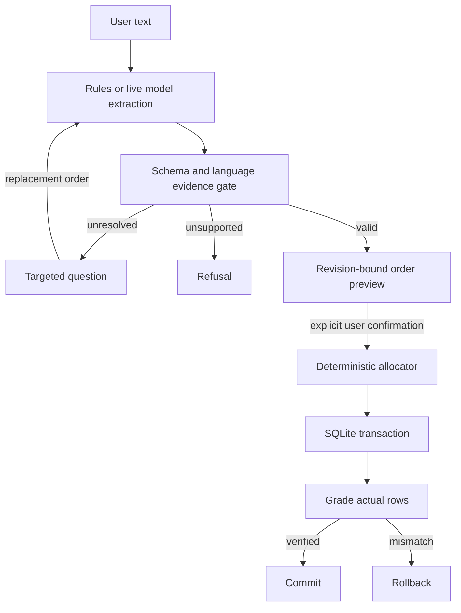

# Chinese order clarification · preregistration

Review of the v0.2 tag: the 15 tests, three legacy traces, 2,200 paired rows and three model trials reproduce. study.plan and grade solve and check structured tasks. They cannot establish whether an order reflects user intent. The CLI provenance erratum is in the historical report on this branch. The prior success rates estimate neither clarification value nor safe language understanding. AmbigQA's separation of plausible readings motivates explicit ambiguity labels here; its open-domain QA scores do not apply. [Original paper](https://aclanthology.org/2020.emnlp-main.466/)

## Contract and design before implementation

One SKU, positive integer quantity (1–20), inclusive minimum expiry calendar date, earliest/latest expiry priority. Synthetic catalog and stock. Require independent explicit confirmation for every write. The model only proposes typed fields and an issue/target. Deterministic code checks schema, identifies unsupported clauses, checks evidence from the user's words and validates the entire resolved order before offering confirmation. The user's answer is a full replacement order for a single revision, never an inferred patch. Ask for a restatement if a partial answer leaves constraints unresolved. New user input invalidates old confirmation. No model interface to confirm or SQL. Reuse the v0.2 planner, market and exchange-condition grader, then check the SQLite rows inside the transaction before commit.

## Sample, policies and budget

100 AI-authored synthetic Chinese orders: 50 development, 50 held out, 10 per initial class per split. Different wording families between splits, shared catalog/rules. No enterprise data or human labels. Freeze labeled JSONL, prompt, methods and selection before evaluating holdout. No tuning on held-out data. A uses deterministic parsing, single pass. B uses a single real extraction. C reuses that exact first extraction and may request one clarification. All three share the guard, allocator, database and confirmer. An abstention without asking earns no clarification credit. The simulated user sends a predefined complete replacement only for a question on the gold target. Confirm only an exact authorized preview, otherwise withhold. Report wrong previews separately: a perfect simulated confirmer can hide extraction mistakes.

Run all methods on both splits. Batch up to ten independent labeled-blind dialogues per real request; send only synthetic texts, no categories, IDs encoding labels, expected fields or confirmations. At most ten initial calls and ten follow-up calls across the campaign. Persist raw replies, batch membership, usage, native CLI version and elapsed time. No forced paid API, retries or restarting a failed campaign. Stop on provider error or visible quota/payment signal. Malformed replies fail closed and stay in results. For B/C the first inference is shared; report physical calls and separate logical exposure. Batch latency and tokens belong to the request, not individual orders. Backend model identity and money unknown unless directly evidenced.

## Metrics by method and split

- Unsafe execution rate: committed incorrect or unauthorized orders / all attempted cases; also report total commits, and incorrect previews / all previews.
- Clarification recall: first targeted question on the correct slot / cases labeled missing, ambiguous or conflicting. Unnecessary clarification: questions on clear cases / clear cases. Average turns: clarification questions / all cases. Confirmation is separate.
- Initial slot accuracy: exact typed matches including null / (4 × cases). Derive initial gold independently of parser; an unresolved slot is null. Record raw first proposal.
- Conflict detection accuracy: correct initial binary conflict classification / all cases. Unsupported detection: true unsupported classifications / gold unsupported cases. Publish predictions for false positives.
- Verified task success: correct committed fills / all cases. Report correct refusals, correct initial questions, unresolved and incorrect execution separately. Also report fills / fulfillable cases (clear or resolved through clarification). Correct refusal never counts as a fill.
- Report physical CLI calls, input/output tokens, latency and unknown fields explicitly. Deterministic A has zero model calls. Inference about the causal value of asking is conditional on these scripted answers and perfect confirmation. No claim of language coverage beyond the conservative input grammar.
